# Prompt: Projeto final de POO, o VetCare (Java)

> Cole este prompt inteiro no Claude Code. Ele é a especificação completa do projeto. Se algo aqui contradisser a apresentação da proposta, **vale este prompt**: ele já corrige os erros que a apresentação tinha.

---

## 1. Contexto

Sou estudante da disciplina de **Programação Orientada a Objetos (POO)**, em **Java**. Apresentei uma proposta de aplicação, o **VetCare**, um sistema de gestão para clínica veterinária, e ela foi **aprovada**. Agora preciso entregar o projeto completo, do início ao fim, indo um pouco além do mínimo para garantir uma nota melhor.

O projeto precisa usar, de forma visível e justificável, **todo o conteúdo estudado até agora**:

1. Classes, objetos, atributos, métodos e construtores
2. Encapsulamento e modificadores de acesso (`private`, `protected`, `public` e o de pacote, sem modificador), getters e setters
3. Herança (`extends`, `super`)
4. Polimorfismo e sobrescrita (`@Override`)
5. Sobrecarga (de construtores e de métodos)
6. Classes abstratas e métodos abstratos
7. Interfaces
8. Associação, agregação e composição
9. UML (diagrama de classes)

**Eu vou estudar e defender este código na frente do professor.** Por isso, clareza vale mais do que esperteza: cada decisão precisa ser explicável por um aluno.

---

## 2. Como você deve trabalhar comigo

- Trabalhe **em etapas** (seção 9). Ao final de cada etapa: compile, mostre o resultado, explique em poucas linhas os conceitos de POO usados naquela etapa e **pare**. Só siga quando eu disser "pode seguir".
- Antes da Etapa 1, rode `java -version` e `javac -version`. Se o JDK for menor que 17, me avise e pare.
- Não pule nenhuma regra de negócio, validação ou método listado aqui. Se achar que algo da especificação está errado, **me pergunte antes** de mudar.
- No fim, rode o checklist da seção 12 inteiro e me mostre item por item.

### Regras de código

- **Java 17**, só a biblioteca padrão. Sem Maven ou Gradle, sem bibliotecas externas e sem JUnit.
- Uma classe pública por arquivo. Pacotes exatamente como na seção 4.
- Identificadores **sem acento** (`Vacinacao`, `Veterinario`). Textos exibidos ao usuário **com acento** (`"Vacinação"`).
- **Não use** streams, lambdas, method references, `var`, `record` nem switch expressions (`->`). Use `for`, `if` e o `switch` clássico. Quero conseguir explicar cada linha.
- Recursos que vão um pouco além do conteúdo (`enum`, `static`, exceções próprias, `Comparable`, `List.copyOf`) **podem** ser usados, mas sempre com um comentário curto explicando o porquê.
- Em cada ponto onde um conceito da disciplina aparece, coloque um comentário marcado assim, para o professor achar fácil:
  `// [POO] Sobrecarga: mesmo nome, parâmetros diferentes.`
- Javadoc curto (1 a 3 linhas) em toda classe e todo método público.
- Comentários em português.
- Compilação com encoding explícito (importante no Windows por causa dos acentos):
  ```
  javac -encoding UTF-8 -d out -sourcepath src src/vetcare/app/Main.java src/vetcare/app/TestesVetCare.java
  java -cp out vetcare.app.Main
  java -cp out vetcare.app.TestesVetCare
  ```
  Se os acentos saírem quebrados no terminal do Windows, explique que dá para rodar `chcp 65001` antes.

---

## 3. O que foi aprovado na proposta (não pode sumir)

A apresentação aprovada tinha 16 slides. Tudo o que está abaixo precisa existir no projeto final:

| Slide | Conteúdo aprovado | Onde fica no projeto |
|---|---|---|
| 1–2 | Clínica veterinária, Java 17+, aplicação de **console**, sem banco de dados | Projeto todo |
| 3 | 6 funcionalidades: cadastro de pessoas (tutores e veterinários com CPF/CRMV), cadastro de animais (cães e gatos ligados ao tutor, cada um com prontuário), atendimentos (consulta, vacinação, cirurgia, cada um com sua regra de preço), agenda (agendar e cancelar por data e horário), prontuário (histórico do animal), faturamento (valor de cada atendimento e total do dia) | Seções 5 e 6 |
| 4 | Mapa conteúdo → código | README (seção 10) |
| 5 | Diagrama de classes UML | Seção 7, **corrigido** |
| 6 | `Prontuario` com `List<String> registros`, `LocalDate abertura`, construtor, `registrar(String)`, `total()` | `Prontuario` |
| 7 | `Animal` com `nome` e `peso` privados, `prontuario` protegido, `getPeso()`, `setPeso()` com validação; CPF **sem setter**; tabela de modificadores | `Animal`, `Pessoa` |
| 8 | 3 hierarquias: Pessoa → Tutor, Veterinario; Animal → Cachorro, Gato; Atendimento → Consulta, Vacinacao, Cirurgia. `Cachorro(nome, peso, raca)` chamando `super(nome, peso)` | `modelo` |
| 9 | `Atendimento` abstrata, `implements Pagavel, Agendavel`, atributos `protected` animal, veterinario, dataHora, construtor `(Animal, Veterinario)`, `abstract String getTipo()` | `Atendimento` |
| 10 | Interfaces `Pagavel { double calcularValor(); }` e `Agendavel { void agendar(LocalDateTime); void cancelar(); }`; tabela "classe abstrata × interface"; ideia de `VendaProduto implements Pagavel` | `contrato`, `VendaProduto` |
| 11 | `calcularValor()`: Consulta = retorno ? 0 : 150; Vacinação = 60 + precoVacina; Cirurgia = 500 + 120 × horas; `faturamentoTotal()` com laço `for (Pagavel p : ...)` | Subclasses e `Clinica` |
| 12 | Sobrecarga: `Consulta(Animal, Veterinario)` chamando `this(a, v, false)`; `agendar(LocalDateTime)` e `agendar(LocalDate, LocalTime)` | `Consulta`, `Atendimento` |
| 13 | Associação (Atendimento → Animal/Veterinario), agregação (Tutor ◇ Animal), composição (Animal ◆ Prontuario criado no construtor) | Seção 6 |
| 14 | Demonstração no `main()` com saída "Consulta \| Rex \| R$ 150,00" etc. | `Main`, **corrigida** (seção 8) |
| 15 | Pacotes `modelo`, `contrato`, `servico`, `app`; próximos passos: exceções, coleções/ordenação, persistência, interface gráfica | Seção 4; exceções e ordenação **já entram**, persistência é extra opcional |
| 16 | Conclusão: classes, construtores, encapsulamento, herança, polimorfismo, sobrecarga, abstratas, interfaces, relacionamentos, UML | Checklist (seção 12) |

### Erros da proposta que este prompt já corrige

Não repita estes erros. Liste-os no README, na seção "Evoluções em relação à proposta":

1. **UML errado:** a `Clinica` estava isolada, ligada só a `Pessoa`. Ela nem conhecia `Atendimento`, `Animal` ou `Prontuario`. Também faltava a associação Atendimento → Veterinario, as setas de herança não eram triângulos vazados e não havia atributos, métodos, visibilidade nem multiplicidades. **A `Clinica` agora é a classe central** (seção 7).
2. **Demo do slide 14:** o tutor e o veterinário nunca eram cadastrados na clínica; a vacinação nunca era agendada (ficava com `dataHora` nula) e mesmo assim entrava no "total do dia"; e a data fixa `05/10/2026` já passou, então agendar nela falharia.
3. **Slide 10:** dizia que a clínica soma "qualquer coisa Pagavel", mas ela só guardava `List<Atendimento>`, então uma `VendaProduto` nunca entraria no faturamento.
4. **Cancelamento sem efeito:** existia `cancelar()`, mas o faturamento somava todos os atendimentos, inclusive os cancelados.
5. **Prontuário sem uso:** nenhum método escrevia no prontuário, então a funcionalidade "histórico do animal" não existia de fato.
6. **Abstratas incompletas:** `Pessoa` e `Animal` eram abstratas sem nenhum método abstrato definido.
7. **Telefone:** o slide 8 dizia que `Pessoa` tem telefone, mas nenhum construtor o recebia.
8. **Classes sem definição:** `Gato` e o construtor de `Cirurgia` apareciam no UML sem nenhuma definição.
9. **Nomes desencontrados:** `faturamentoTotal()` (slide 11) e "total do dia"/`imprimirResumo()` (slide 14) não batiam. Agora existem os três, cada um com papel definido.
10. **Validação fraca:** `setPeso()` ignorava valores inválidos em silêncio e o construtor de `Animal` não validava nada. Agora há exceções próprias (era um "próximo passo" do slide 15).
11. **Composição fraca:** o construtor público de `Prontuario` deixava qualquer classe criar um prontuário solto. Agora ele é **de pacote**, e só `Animal` cria.

---

## 4. Estrutura do projeto

```
vetcare/
├── README.md
├── docs/
│   ├── uml-vetcare.mmd          (fonte Mermaid da seção 7)
│   ├── uml-vetcare.puml         (versão PlantUML com a Clinica no centro)
│   ├── uml-vetcare.png          (imagem do diagrama)
│   ├── roteiro-apresentacao.md
│   └── ajustes-nos-slides.md
└── src/vetcare/
    ├── app/        Main, MenuConsole, TestesVetCare
    ├── contrato/   Pagavel, Agendavel
    ├── excecao/    DadoInvalidoException, OperacaoInvalidaException
    ├── modelo/     Pessoa, Tutor, Veterinario, Animal, Cachorro, Gato, Prontuario,
    │               Atendimento, Consulta, Vacinacao, Cirurgia, StatusAtendimento, VendaProduto
    ├── servico/    Clinica
    └── util/       Formatador
```

Pacote raiz: `vetcare` (ex.: `package vetcare.modelo;`).

---

## 5. Especificação das classes

As assinaturas devem bater **exatamente** com o UML da seção 7. Todas as mensagens de erro ficam em português.

### `vetcare.contrato`
- `interface Pagavel { double calcularValor(); }`
- `interface Agendavel { void agendar(LocalDateTime dataHora); void cancelar(); }`

### `vetcare.excecao`
- `DadoInvalidoException extends RuntimeException`, para dados de entrada inválidos (nome vazio, CPF mal formado, peso ≤ 0...). Construtor `(String mensagem)`.
- `OperacaoInvalidaException extends RuntimeException`, para regras de negócio violadas (CPF duplicado, cancelar algo já realizado, agendar no passado...). Construtor `(String mensagem)`.
- Comente no código por que são *unchecked*: deixam o código das regras mais limpo, e o `main`/menu captura e mostra a mensagem. Elas também são mais um exemplo de herança.

### `vetcare.util.Formatador` (classe utilitária)
- Construtor `private`: ninguém instancia.
- `static String moeda(double)`: `NumberFormat.getCurrencyInstance(Locale.forLanguageTag("pt-BR"))`, gera "R$ 150,00".
- `static String dataHora(LocalDateTime)`: "dd/MM/yyyy HH:mm"; se nulo, devolve "sem data".
- `static String data(LocalDate)`: "dd/MM/yyyy".

### `vetcare.modelo.Pessoa` (abstrata)
- `private String nome`, `private final String cpf`, `private String telefone`.
- `Pessoa(nome, cpf)` chama `this(nome, cpf, "não informado")` **[sobrecarga de construtor]**; `Pessoa(nome, cpf, telefone)`.
- O nome é obrigatório (não nulo, não vazio, sem espaços nas pontas); se não vier, lança `DadoInvalidoException`.
- `private String normalizarCpf(String)`: remove tudo que não é dígito. O resultado precisa ter 11 dígitos e não pode ter todos iguais; senão, `DadoInvalidoException`. **Não** valide dígitos verificadores, porque os CPFs da demo são fictícios. Guarde só os dígitos.
- Getters de tudo; `setNome` (com a mesma validação) e `setTelefone`. **Sem `setCpf`**: o CPF não muda depois do cadastro (slide 7).
- `public abstract String getDescricao();`
- `toString()` devolve `getDescricao()` **[polimorfismo: a Pessoa não sabe qual descrição vai sair]**.

### `Tutor extends Pessoa`
- `private final List<Animal> animais = new ArrayList<>();`
- Dois construtores (com e sem telefone), ambos chamando `super(...)`.
- `adicionarAnimal(Animal)`: nulo lança `DadoInvalidoException`; animal repetido lança `OperacaoInvalidaException`.
- `removerAnimal(Animal)`: devolve `boolean`.
- `getAnimais()`: devolve `List.copyOf(animais)`, para ninguém mexer na lista por fora **[encapsulamento]**.
- `getDescricao()`: `"Tutor: Ana Souza (2 animais)"`.
- **[POO] Agregação:** o tutor agrupa animais que existem sem ele.

### `Veterinario extends Pessoa`
- `private final String crmv` (obrigatório), `private String especialidade`.
- `Veterinario(nome, cpf, crmv)` chama `this(nome, cpf, crmv, "Clínico geral")`; `Veterinario(nome, cpf, crmv, especialidade)`.
- Getters, `setEspecialidade`; sem setter de CRMV.
- `getDescricao()`: `"Veterinário(a): Luís Lima — CRMV 1234 (Clínico geral)"`.

### `Animal` (abstrata)
- `private String nome`, `private double peso`, `protected final Prontuario prontuario` (slide 7).
- Construtor `(String nome, double peso)`: valida o nome, faz `this.peso = validarPeso(peso)` e `this.prontuario = new Prontuario()` **[composição: o prontuário nasce e morre com o animal]**.
- `private double validarPeso(double)`: peso ≤ 0 lança `DadoInvalidoException`. É usado no construtor e em `setPeso`. Comente por que o construtor não chama `setPeso` direto: evita chamar um método sobrescrevível dentro do construtor.
- `getNome()`, `getPeso()`, `setPeso(double)`, `getProntuario()`.
- `public abstract String getEspecie();`
- `toString()`: `"Rex (Cachorro, 12,5 kg)"`, usando `getEspecie()`.
- O animal **não** guarda referência ao tutor (a agregação é unidirecional). Explique isso no README.

### `Cachorro extends Animal`
- `private String raca`; construtor `(nome, peso, raca)` com `super(nome, peso)` (igual ao slide 8). Raça vazia vira `"SRD"`.
- `getRaca()`, `getEspecie()` → `"Cachorro"`.
- `toString()` sobrescrito: `super.toString() + " - Labrador"` **[uso de super.metodo()]**.

### `Gato extends Animal`
- `private boolean castrado`; `Gato(nome, peso)` chama `this(nome, peso, false)`; `Gato(nome, peso, castrado)`.
- `isCastrado()`, `getEspecie()` → `"Gato"`.

### `Prontuario`
- `private final List<String> registros = new ArrayList<>();`, `private final LocalDate abertura;`
- Construtor **de pacote** (sem modificador): `Prontuario() { abertura = LocalDate.now(); }`. Comente que é o **quarto modificador de acesso** e que reforça a composição, porque só classes do pacote `modelo` (na prática, `Animal`) criam prontuários.
- `registrar(String anotacao)`: anotação vazia lança `DadoInvalidoException`.
- `total()`, `getRegistros()` (com `List.copyOf`), `getAbertura()`.

### `StatusAtendimento` (enum)
- `PENDENTE, AGENDADO, REALIZADO, CANCELADO`.

### `Atendimento` (abstrata) `implements Pagavel, Agendavel, Comparable<Atendimento>`
- `private static int proximoId = 1;` e `private final int id;` (`id = proximoId++` no construtor). Comente o `static`: o contador é compartilhado por todos os objetos.
- `protected Animal animal; protected Veterinario veterinario; protected LocalDateTime dataHora;` (slide 9).
- `private StatusAtendimento status`, que começa em `PENDENTE`.
- Construtor `(Animal animal, Veterinario veterinario)`: argumentos nulos lançam `DadoInvalidoException`.
- `agendar(LocalDateTime)` **[@Override de Agendavel]**:
  - nulo lança `DadoInvalidoException`;
  - status REALIZADO ou CANCELADO lança `OperacaoInvalidaException`;
  - data no passado lança `OperacaoInvalidaException("Não é possível agendar no passado.")`;
  - caso contrário, guarda a data e o status vira AGENDADO. Reagendar um atendimento AGENDADO é permitido.
- `agendar(LocalDate dia, LocalTime hora)` **[sobrecarga]**: só chama `agendar(LocalDateTime.of(dia, hora))`. Comente que, por isso, a regra da `Cirurgia` também vale nesta versão **[polimorfismo]**.
- `cancelar()` **[@Override]**: REALIZADO lança `OperacaoInvalidaException("Não é possível cancelar um atendimento já realizado.")`; já CANCELADO lança `OperacaoInvalidaException`; senão, o status vira CANCELADO.
- `realizar()`: só a partir de AGENDADO (senão, `OperacaoInvalidaException`); o status vira REALIZADO.
- Getters: `getId`, `getAnimal`, `getVeterinario`, `getDataHora`, `getStatus`.
- `compareTo(Atendimento outro)`: ordena por `dataHora` (nulos por último; empate desempata pelo id). É usado na agenda do dia.
- `public abstract String getTipo();`. `calcularValor()` fica sem implementação aqui: cada subclasse é obrigada a implementar (slide 9).
- `toString()`: `"#1 Consulta | Rex | Luís Lima | 14/11/2026 14:00 | R$ 150,00 | REALIZADO"`.

### `Consulta extends Atendimento`
- `private static final double VALOR_CONSULTA = 150.0;`, `private boolean retorno`.
- `Consulta(Animal a, Veterinario v)` chama `this(a, v, false)`; `Consulta(Animal a, Veterinario v, boolean retorno)` faz `super(a, v)` (igual ao slide 12).
- `calcularValor()` devolve `retorno ? 0.0 : VALOR_CONSULTA` (o retorno é gratuito).
- `getTipo()` devolve `"Consulta (retorno)"` ou `"Consulta"`. Também `isRetorno()`.

### `Vacinacao extends Atendimento`
- `private static final double TAXA_APLICACAO = 60.0;`, `private String nomeVacina`, `private double precoVacina` (preço < 0 lança `DadoInvalidoException`).
- `Vacinacao(a, v, precoVacina)` chama `this(a, v, "Não informada", precoVacina)`; `Vacinacao(a, v, nomeVacina, precoVacina)`.
- `calcularValor()` devolve `TAXA_APLICACAO + precoVacina`; `getTipo()` devolve `"Vacinação"`. Também os getters.

### `Cirurgia extends Atendimento`
- `private static final double VALOR_BASE = 500.0;`, `private static final double VALOR_HORA = 120.0;`, `private int horas` (≥ 1; senão, `DadoInvalidoException`).
- Construtor `(Animal, Veterinario, int horas)`; `getHoras()`.
- **Sobrescreve `agendar(LocalDateTime)`**: se a data for antes de `LocalDateTime.now().plusHours(24)`, lança `OperacaoInvalidaException("Cirurgias exigem 24 horas de antecedência.")`; senão, chama `super.agendar(dataHora)`.
- `calcularValor()` devolve `VALOR_BASE + VALOR_HORA * horas`; `getTipo()` devolve `"Cirurgia"`.

### `VendaProduto implements Pagavel` (extra: a ideia do slide 10 virando código)
- `private String descricao` (obrigatória), `private double precoUnitario` (> 0), `private int quantidade` (≥ 1), `private final LocalDate data` (= `LocalDate.now()`).
- `calcularValor()` devolve `precoUnitario * quantidade`. Getters e `toString()` (`"Ração 1kg x2 | R$ 90,00"`).
- Comente: **não é um Atendimento**, mas entra no faturamento só por ser `Pagavel` **[interface × herança]**.

### `vetcare.servico.Clinica` (a classe central)
- `private final String nome`. Listas privadas e finais: `tutores`, `veterinarios`, `atendimentos`, `vendas`.
- `cadastrar(Tutor)` e `cadastrar(Veterinario)` **[sobrecarga de método]**: nulo lança `DadoInvalidoException`; CPF já cadastrado (em tutores **ou** veterinários) lança `OperacaoInvalidaException`; CRMV repetido também.
- `buscarTutorPorCpf(String)` (normaliza os dígitos antes de comparar), `buscarVeterinarioPorCrmv(String)`, `buscarAtendimentoPorId(int)`: devolvem `null` quando não acham (documente no Javadoc).
- `buscarAnimaisPorNome(String)`: percorre os tutores e os animais de cada um (comparação sem diferenciar maiúsculas) e devolve uma lista nova.
- `registrar(Atendimento)`:
  - nulo lança `DadoInvalidoException`;
  - já registrado, veterinário não cadastrado, ou animal que não pertence a nenhum tutor cadastrado lança `OperacaoInvalidaException`;
  - só aceita status PENDENTE ou AGENDADO;
  - extra: se estiver AGENDADO e o mesmo veterinário já tiver outro atendimento AGENDADO no mesmo `dataHora`, lança `OperacaoInvalidaException("Conflito de horário...")`.
- `realizarAtendimento(Atendimento, String observacao)`: o atendimento precisa estar registrado nesta clínica. Chama `a.realizar()` e **escreve no prontuário** do animal: `a.getAnimal().getProntuario().registrar("[14/11/2026 14:00] Consulta — Veterinário(a) Luís Lima: Check-up geral")` **[a Clinica conhece e usa o Prontuario]**.
- `cancelarAtendimento(Atendimento)`: precisa estar registrado; chama `a.cancelar()`.
- `consultarProntuario(Animal)`: o animal precisa ser de um tutor cadastrado (senão, `OperacaoInvalidaException`); devolve `animal.getProntuario()`.
- `registrarVenda(VendaProduto)`.
- `agendaDoDia(LocalDate)`: atendimentos AGENDADOS ou REALIZADOS daquele dia, ordenados com `Collections.sort(lista)` (usa o `compareTo`) **[Comparable: ordenação, que era próximo passo do slide 15]**.
- `faturamentoTotal()`: monta uma `List<Pagavel>` com os atendimentos **REALIZADOS** e todas as vendas, e soma com `for (Pagavel p : cobraveis) total += p.calcularValor();` **[polimorfismo via interface, como no slide 11]**. Atendimentos cancelados, pendentes ou só agendados não entram.
- `faturamentoDoDia(LocalDate)`: mesma lógica, filtrando atendimentos realizados com `dataHora` naquele dia e vendas com `data` naquele dia.
- `imprimirResumo()`: cabeçalho com o nome da clínica, todos os atendimentos (`toString`, com status), as vendas e a linha `"Faturamento (realizados + vendas): R$ 390,00"`.

---

## 6. Relacionamentos (como devem aparecer no código e no UML)

| Relacionamento | Entre | No código |
|---|---|---|
| Herança | Pessoa → Tutor, Veterinario; Animal → Cachorro, Gato; Atendimento → Consulta, Vacinacao, Cirurgia; RuntimeException → as duas exceções | `extends` + `super(...)` |
| Realização (interface) | Atendimento → Pagavel, Agendavel, Comparable; VendaProduto → Pagavel | `implements` |
| Agregação | Clinica ◇ Tutor, Veterinario, Atendimento, VendaProduto (0..*); Tutor ◇ Animal (0..*) | listas de objetos criados fora |
| Composição | Animal ◆ Prontuario (1 para 1) | `new Prontuario()` dentro do construtor de Animal, `final`, construtor de pacote |
| Associação | Atendimento → Animal (1), Atendimento → Veterinario (1), Atendimento → StatusAtendimento | atributos de referência |
| Dependência («usa») | Clinica → Animal (busca), Clinica → Prontuario (consulta e escreve), Clinica → Pagavel (faturamento) | parâmetros, variáveis locais |

---

## 7. UML de classes corrigido (fonte oficial)

Este é o diagrama **corrigido**. A `Clinica` é o centro do sistema: ela agrega tutores, veterinários, atendimentos e vendas, e usa animais, prontuários e o contrato `Pagavel`. A sintaxe abaixo já foi validada no Mermaid.

O código Java precisa bater com o diagrama, e o diagrama com o código. Se mudar um, mude o outro.

**Observações de leitura:**

- `Comparable` é o `java.lang.Comparable<Atendimento>`.
- `$` marca membro estático; `*` marca método abstrato.
- `-` é private, `#` é protected, `+` é public, `~` é de pacote.
- `Formatador` é usado por `toString()` e pela `Clinica` (as setas foram omitidas para não poluir).

```mermaid
classDiagram
direction TB

class Pagavel {
  <<interface>>
  +calcularValor() double
}
class Agendavel {
  <<interface>>
  +agendar(LocalDateTime dataHora) void
  +cancelar() void
}
class Comparable {
  <<interface>>
  +compareTo(Atendimento outro) int
}

class Clinica {
  -String nome
  -List~Tutor~ tutores
  -List~Veterinario~ veterinarios
  -List~Atendimento~ atendimentos
  -List~VendaProduto~ vendas
  +Clinica(String nome)
  +cadastrar(Tutor tutor) void
  +cadastrar(Veterinario veterinario) void
  +buscarTutorPorCpf(String cpf) Tutor
  +buscarVeterinarioPorCrmv(String crmv) Veterinario
  +buscarAnimaisPorNome(String nome) List~Animal~
  +buscarAtendimentoPorId(int id) Atendimento
  +registrar(Atendimento atendimento) void
  +realizarAtendimento(Atendimento atendimento, String observacao) void
  +cancelarAtendimento(Atendimento atendimento) void
  +consultarProntuario(Animal animal) Prontuario
  +registrarVenda(VendaProduto venda) void
  +agendaDoDia(LocalDate dia) List~Atendimento~
  +faturamentoTotal() double
  +faturamentoDoDia(LocalDate dia) double
  +imprimirResumo() void
}

class Pessoa {
  <<abstract>>
  -String nome
  -String cpf
  -String telefone
  +Pessoa(String nome, String cpf)
  +Pessoa(String nome, String cpf, String telefone)
  +getNome() String
  +setNome(String nome) void
  +getCpf() String
  +getTelefone() String
  +setTelefone(String telefone) void
  +getDescricao()* String
  +toString() String
  -normalizarCpf(String cpf) String
}
class Tutor {
  -List~Animal~ animais
  +Tutor(String nome, String cpf)
  +Tutor(String nome, String cpf, String telefone)
  +adicionarAnimal(Animal animal) void
  +removerAnimal(Animal animal) boolean
  +getAnimais() List~Animal~
  +getDescricao() String
}
class Veterinario {
  -String crmv
  -String especialidade
  +Veterinario(String nome, String cpf, String crmv)
  +Veterinario(String nome, String cpf, String crmv, String especialidade)
  +getCrmv() String
  +getEspecialidade() String
  +setEspecialidade(String especialidade) void
  +getDescricao() String
}

class Animal {
  <<abstract>>
  -String nome
  -double peso
  #Prontuario prontuario
  +Animal(String nome, double peso)
  +getNome() String
  +getPeso() double
  +setPeso(double peso) void
  +getProntuario() Prontuario
  +getEspecie()* String
  +toString() String
  -validarPeso(double peso) double
}
class Cachorro {
  -String raca
  +Cachorro(String nome, double peso, String raca)
  +getRaca() String
  +getEspecie() String
  +toString() String
}
class Gato {
  -boolean castrado
  +Gato(String nome, double peso)
  +Gato(String nome, double peso, boolean castrado)
  +isCastrado() boolean
  +getEspecie() String
}
class Prontuario {
  -List~String~ registros
  -LocalDate abertura
  ~Prontuario()
  +registrar(String anotacao) void
  +total() int
  +getRegistros() List~String~
  +getAbertura() LocalDate
}

class Atendimento {
  <<abstract>>
  -int proximoId$
  -int id
  #Animal animal
  #Veterinario veterinario
  #LocalDateTime dataHora
  -StatusAtendimento status
  +Atendimento(Animal animal, Veterinario veterinario)
  +agendar(LocalDateTime dataHora) void
  +agendar(LocalDate dia, LocalTime hora) void
  +cancelar() void
  +realizar() void
  +getId() int
  +getAnimal() Animal
  +getVeterinario() Veterinario
  +getDataHora() LocalDateTime
  +getStatus() StatusAtendimento
  +compareTo(Atendimento outro) int
  +getTipo()* String
  +calcularValor()* double
  +toString() String
}
class Consulta {
  -double VALOR_CONSULTA$
  -boolean retorno
  +Consulta(Animal animal, Veterinario veterinario)
  +Consulta(Animal animal, Veterinario veterinario, boolean retorno)
  +isRetorno() boolean
  +calcularValor() double
  +getTipo() String
}
class Vacinacao {
  -double TAXA_APLICACAO$
  -String nomeVacina
  -double precoVacina
  +Vacinacao(Animal animal, Veterinario veterinario, double precoVacina)
  +Vacinacao(Animal animal, Veterinario veterinario, String nomeVacina, double precoVacina)
  +getNomeVacina() String
  +getPrecoVacina() double
  +calcularValor() double
  +getTipo() String
}
class Cirurgia {
  -double VALOR_BASE$
  -double VALOR_HORA$
  -int horas
  +Cirurgia(Animal animal, Veterinario veterinario, int horas)
  +getHoras() int
  +agendar(LocalDateTime dataHora) void
  +calcularValor() double
  +getTipo() String
}
class StatusAtendimento {
  <<enumeration>>
  PENDENTE
  AGENDADO
  REALIZADO
  CANCELADO
}
class VendaProduto {
  -String descricao
  -double precoUnitario
  -int quantidade
  -LocalDate data
  +VendaProduto(String descricao, double precoUnitario, int quantidade)
  +getDescricao() String
  +getPrecoUnitario() double
  +getQuantidade() int
  +getData() LocalDate
  +calcularValor() double
  +toString() String
}

class Formatador {
  <<utility>>
  -Formatador()
  +moeda(double valor)$ String
  +dataHora(LocalDateTime dataHora)$ String
  +data(LocalDate data)$ String
}

class RuntimeException
class DadoInvalidoException {
  +DadoInvalidoException(String mensagem)
}
class OperacaoInvalidaException {
  +OperacaoInvalidaException(String mensagem)
}

%% Clínica no centro: conhece todos os cadastros, os atendimentos, as vendas e o prontuário
Clinica "1" o-- "0..*" Tutor : cadastra
Clinica "1" o-- "0..*" Veterinario : cadastra
Clinica "1" o-- "0..*" Atendimento : registra
Clinica "1" o-- "0..*" VendaProduto : registra
Clinica ..> Animal : usa (busca)
Clinica ..> Prontuario : usa (consulta e escreve)
Clinica ..> Pagavel : usa (soma no faturamento)

%% Herança
Pessoa <|-- Tutor
Pessoa <|-- Veterinario
Animal <|-- Cachorro
Animal <|-- Gato
Atendimento <|-- Consulta
Atendimento <|-- Vacinacao
Atendimento <|-- Cirurgia
RuntimeException <|-- DadoInvalidoException
RuntimeException <|-- OperacaoInvalidaException

%% Interfaces
Pagavel <|.. Atendimento
Agendavel <|.. Atendimento
Comparable <|.. Atendimento
Pagavel <|.. VendaProduto

%% Relacionamentos do domínio
Tutor "1" o-- "0..*" Animal : possui
Animal "1" *-- "1" Prontuario : tem
Atendimento "0..*" --> "1" Animal : atende
Atendimento "0..*" --> "1" Veterinario : realizado por
Atendimento --> "1" StatusAtendimento : status
```



### Imagem do diagrama, com a Clinica no centro

O Mermaid não deixa controlar a posição das caixas. Por isso, gere também `docs/uml-vetcare.puml` (PlantUML) com **o mesmo conteúdo** e dicas de direção nas setas (`-up-`, `-down-`, `-left-`, `-right-`), seguindo este layout:

- **Clinica no centro.**
- **Acima:** as interfaces (`Pagavel`, `Agendavel`, `Comparable`).
- **À esquerda:** a hierarquia `Pessoa` (`Tutor`, `Veterinario`).
- **À direita:** a hierarquia `Atendimento` (`Consulta`, `Vacinacao`, `Cirurgia`) e o `StatusAtendimento`.
- **Abaixo:** a hierarquia `Animal` (`Cachorro`, `Gato`) e o `Prontuario`.
- **Num canto:** `VendaProduto`, as exceções e o `Formatador`.

Use as setas UML corretas: herança com triângulo vazado, interface tracejada com triângulo, agregação com losango vazado, composição com losango cheio, dependência tracejada com «usa», e multiplicidades nas pontas. Agrupe as classes em `package` por pacote Java.

Para gerar `docs/uml-vetcare.png`, use o que estiver disponível: `plantuml` instalado, `npx @mermaid-js/mermaid-cli` a partir do `.mmd`, ou, se nada funcionar, me diga para colar o `.puml` em plantuml.com ou na extensão PlantUML do VS Code.

---

## 8. Demonstração (`Main`), corrigida

O `Main` mostra o menu `1 - Demonstração automática | 2 - Menu interativo | 0 - Sair`.

A **demonstração automática** segue este roteiro, imprimindo um título antes de cada bloco. Use datas **relativas** (`LocalDate.now().plusDays(1)`), nunca datas fixas.

1. **Cadastros**
   - Cria `new Clinica("VetCare")`.
   - Cria `Tutor ana = new Tutor("Ana Souza", "111.222.333-44", "(11) 98888-7777")`, `Cachorro rex = new Cachorro("Rex", 12.5, "Labrador")` e `Gato mia = new Gato("Mia", 4.2, true)`. Adiciona os dois animais à Ana.
   - Cria `Veterinario luis = new Veterinario("Luís Lima", "555.666.777-88", "CRMV 1234")`.
   - **Cadastra a Ana e o Luís na clínica** (as duas versões de `cadastrar`).
2. **Agendamentos** (com `amanha = LocalDate.now().plusDays(1)`)
   - `Consulta c = new Consulta(rex, luis)`, agendada com `c.agendar(amanha, LocalTime.of(14, 0))` (versão sobrecarregada).
   - `Vacinacao v = new Vacinacao(mia, luis, "V4 felina", 90.0)`, agendada com `v.agendar(LocalDateTime.of(amanha, LocalTime.of(15, 0)))`.
   - `Consulta r = new Consulta(rex, luis, true)` (retorno), agendada amanhã às 16h.
   - `Cirurgia cir = new Cirurgia(rex, luis, 2)`. Primeiro tenta `cir.agendar(LocalDateTime.now().plusHours(2))`: a exceção é **capturada e a mensagem impressa**. Depois agenda daqui a 3 dias, às 9h.
3. **Registro:** registra na ordem **r, c, v, cir** (fora de ordem de propósito, para a agenda mostrar a ordenação).
4. **Atendimento:** realiza `c` ("Check-up geral, sem alterações"), `v` ("Vacina aplicada sem reações") e `r` ("Retorno: tudo certo"). Cancela `cir`. Registra a venda `new VendaProduto("Ração 1kg", 45.0, 2)`.
5. **Agenda de amanhã:** imprime `agendaDoDia(amanha)`. Devem sair 3 itens, ordenados às 14h, 15h e 16h.
6. **Prontuários:** imprime o prontuário do Rex (2 registros) e o da Mia (1 registro).
7. **Resumo e faturamento:** chama `imprimirResumo()` e imprime `faturamentoDoDia(amanha)` e `faturamentoDoDia(LocalDate.now())`.
8. **Erros tratados:** cada um num `try/catch` que imprime a mensagem.
   - `new Tutor("Teste", "123")` gera `DadoInvalidoException`.
   - `rex.setPeso(-3)` gera `DadoInvalidoException`.
   - `clinica.cadastrar(ana)` de novo gera `OperacaoInvalidaException`.
   - Cancelar `c`, que já foi realizada, gera `OperacaoInvalidaException`.
9. Um comentário no código lembrando que `new Atendimento(rex, luis)` **nem compila** (classe abstrata).

**Valores esperados (confira de verdade na saída):**

| Item | Valor | Entra no faturamento? |
|---|---|---|
| Consulta (Rex) | R$ 150,00 | Sim, realizada |
| Vacinação (Mia) | 60 + 90 = R$ 150,00 | Sim, realizada |
| Consulta de retorno (Rex) | R$ 0,00 | Sim, realizada (gratuita) |
| Cirurgia (Rex, 2 h) | 500 + 240 = R$ 740,00 | **Não**, cancelada |
| Ração 1kg × 2 | R$ 90,00 | Sim |

- `faturamentoTotal()` = **R$ 390,00**
- `faturamentoDoDia(amanhã)` = **R$ 300,00**
- `faturamentoDoDia(hoje)` = **R$ 90,00**

Comente no código que, na demo, os atendimentos de amanhã são "realizados" hoje só para simular o dia.

### Menu interativo (`MenuConsole`, extra)

Usa `Scanner`, com `switch` clássico em laço. Opções:

1. Cadastrar tutor
2. Cadastrar veterinário
3. Cadastrar animal para um tutor (pelo CPF)
4. Novo atendimento (escolhe tipo, animal, veterinário pelo CRMV, data e hora)
5. Realizar atendimento (pelo id)
6. Cancelar atendimento (pelo id)
7. Ver prontuário de um animal
8. Agenda do dia
9. Resumo e faturamento
10. Registrar venda de produto
0. Voltar

Regras do menu:

- Toda exceção é capturada e mostrada como mensagem amigável. O menu **nunca** pode quebrar, nem com letra onde se espera número.
- Ao abrir, o menu já vem com os dados da demonstração carregados, para eu conseguir testar rápido.

---

## 9. Etapas (pare ao fim de cada uma)

1. **Estrutura:** pastas, `contrato`, `excecao`, `StatusAtendimento`, `Formatador`. Compile.
2. **Pessoas:** `Pessoa`, `Tutor`, `Veterinario`. Compile.
3. **Animais:** `Animal`, `Cachorro`, `Gato`, `Prontuario`. Compile.
4. **Atendimentos:** `Atendimento`, `Consulta`, `Vacinacao`, `Cirurgia`, `VendaProduto`. Compile.
5. **Clínica:** `Clinica`. Compile.
6. **Aplicação:** `Main` (demo) e `MenuConsole`. Compile, rode a demo e **confira os valores da seção 8**.
7. **Testes:** `TestesVetCare` (seção 11). Rode e mostre o placar.
8. **Documentação:** UML (`.mmd`, `.puml`, `.png`) e README (seção 10).
9. **Apresentação final:** `docs/roteiro-apresentacao.md` e `docs/ajustes-nos-slides.md` (seção 10).
10. **(Opcional, só se eu pedir)** Persistência simples em arquivo texto (salvar e carregar tutores e animais), que era o 3º próximo passo do slide 15. Não faça isso sem eu pedir.

Em cada etapa, me diga: o que foi criado, os conceitos de POO que apareceram (com arquivo e método) e uma pergunta que o professor poderia fazer sobre aquela parte.

---

## 10. Documentação e material da apresentação final

### `README.md`

1. Descrição do VetCare (2 parágrafos).
2. Como compilar e rodar (Windows e Linux/macOS), com os comandos da seção 2.
3. Estrutura de pastas.
4. Diagrama: a imagem `docs/uml-vetcare.png` e o bloco Mermaid (o GitHub renderiza).
5. **Tabela "Conteúdo da disciplina → onde está no código"**, com arquivo e método para cada um dos 9 conteúdos da seção 1, incluindo os 4 modificadores de acesso.
6. Decisões de projeto, uma frase de justificativa cada:
   - CPF sem setter;
   - construtor de `Prontuario` de pacote;
   - exceções *unchecked*;
   - `List.copyOf` nos getters;
   - agregação Tutor → Animal unidirecional;
   - faturamento só de realizados;
   - `Comparable` na agenda;
   - `agendar` sobrescrito na `Cirurgia`.
7. Evoluções em relação à proposta: os 11 itens da seção 3.
8. Limitações conhecidas:
   - sem persistência;
   - o conflito de horário só é checado no `registrar`;
   - o CPF não valida dígitos verificadores;
   - na demo, atendimentos futuros são "realizados" para simulação.

### `docs/roteiro-apresentacao.md`

- Roteiro de 8 a 10 minutos: abertura, UML (começando pela `Clinica` no centro), um trecho de código por conceito e a demo ao vivo, com o que falar em cada parte.
- **12 perguntas prováveis do professor, com respostas curtas**, por exemplo:
  - agregação × composição no projeto;
  - por que `Atendimento` é abstrata e não interface;
  - sobrecarga × sobrescrita (com os exemplos do código);
  - por que `protected` em `Atendimento`;
  - por que o construtor de `Prontuario` é de pacote;
  - o que acontece se chamar `agendar(dia, hora)` numa `Cirurgia`;
  - por que `static` no contador de id;
  - por que exceções próprias;
  - como `faturamentoTotal()` soma objetos de tipos diferentes;
  - o que muda para adicionar um novo tipo de atendimento (ex.: `BanhoETosa`);
  - por que o tutor conhece o animal, mas o animal não conhece o tutor;
  - por que a `Clinica` é a classe central.

### `docs/ajustes-nos-slides.md`

Lista do que mudar na apresentação para ela bater com o código final, slide por slide:

- **5:** UML novo.
- **6:** construtor de pacote em `Prontuario`.
- **7:** `setPeso` com exceção.
- **10:** `VendaProduto` implementado.
- **11:** constantes e faturamento só de realizados.
- **14:** demo corrigida.
- **15:** pacotes `excecao` e `util`, e próximos passos atualizados.

---

## 11. Testes (`TestesVetCare`, sem JUnit)

Crie um método auxiliar `verificar(boolean condicao, String descricao)`, que imprime `[OK]` ou `[FALHOU]` e conta os acertos. No fim, imprime `"X de Y testes passaram"` e usa `System.exit(1)` se algum falhar.

No mínimo, teste:

1. Consulta = 150, retorno = 0, Vacinação(90) = 150, Cirurgia(2 h) = 740, VendaProduto(45 × 2) = 90.
2. As duas versões de `agendar` produzem o mesmo `dataHora`.
3. Agendar no passado lança `OperacaoInvalidaException`.
4. Cirurgia com menos de 24 h lança exceção, **inclusive pela versão `agendar(dia, hora)`** (prova do polimorfismo).
5. Cancelado não entra no faturamento; realizado entra; só agendado não entra.
6. Cancelar um realizado lança exceção; realizar um pendente lança exceção.
7. CPF com menos de 11 dígitos lança `DadoInvalidoException`; CPF com pontuação é aceito e normalizado.
8. Peso ≤ 0 lança exceção, no construtor e no `setPeso`.
9. CPF duplicado na clínica lança exceção (tutor × veterinário também).
10. Registrar um atendimento de animal sem tutor cadastrado lança exceção.
11. Depois de `realizarAtendimento`, o prontuário do animal tem 1 registro a mais.
12. `getAnimais().add(...)` lança `UnsupportedOperationException` (encapsulamento).
13. `agendaDoDia` sai ordenada por horário.
14. Os ids dos atendimentos são sequenciais e únicos.
15. `toString()` de uma `Pessoa` devolve `getDescricao()` da subclasse (polimorfismo).

---

## 12. Checklist final (rode e me mostre item por item)

- [ ] Compila sem erros nem warnings com o comando da seção 2.
- [ ] A demo imprime R$ 390,00 / R$ 300,00 / R$ 90,00 e a agenda ordenada às 14h, 15h e 16h.
- [ ] `TestesVetCare`: todos passam.
- [ ] Todas as classes, atributos e métodos do UML existem no código com a mesma visibilidade, e vice-versa.
- [ ] A `Clinica` está no centro da imagem do UML e ligada a Tutor, Veterinario, Atendimento, VendaProduto, Animal, Prontuario e Pagavel.
- [ ] Cada um dos 9 conteúdos da seção 1 tem pelo menos um comentário `[POO]` no código e uma linha na tabela do README.
- [ ] Os 4 modificadores de acesso aparecem e estão justificados.
- [ ] Sobrecarga aparece em construtores (Pessoa, Tutor, Veterinario, Gato, Consulta, Vacinacao) e em métodos (`agendar`, `cadastrar`).
- [ ] Sobrescrita aparece em `calcularValor`, `getTipo`, `getDescricao`, `getEspecie`, `toString`, `agendar` (Cirurgia) e `compareTo`.
- [ ] Nada de streams, lambdas, `var` ou `record`.
- [ ] Os 16 slides da seção 3 estão cobertos e os 11 erros da proposta foram corrigidos.
- [ ] README, roteiro, perguntas e ajustes nos slides foram entregues.
- [ ] Nenhuma data fixa no código da demo.
